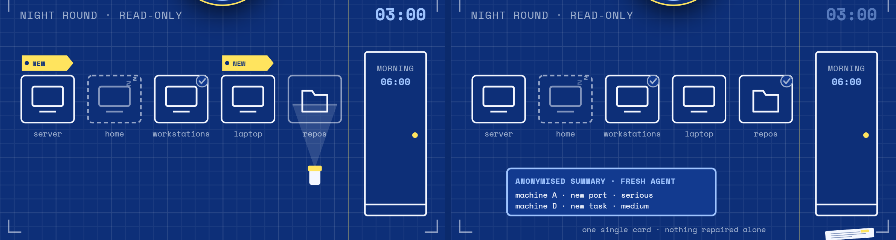
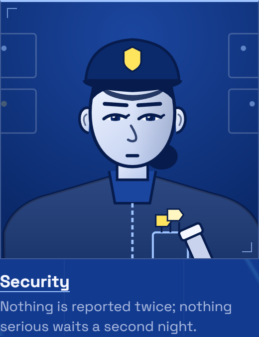

# Agent - Security

Every night it checks, read-only, every machine its owner's agents can reach, and reports only what is new or has changed.

**English** · [Français](#version-française)

> Showcase repository: the code and data of this project are private; this README describes it.

*Nothing is reported twice; nothing serious waits a second night.*

## What it does

- **Surveys every machine of the agent system, read-only**: the server at night, the home computer if it is on (it is never woken up), the laptop in the afternoon, the shared compute workstations through the workstation fleet keeper, and the public repositories.
- **Looks for new ways in**: listening ports, services, scheduled tasks, hooks, tool servers, mods and containers that were not there the night before; pages that open without a password on the private network.
- **Looks for what should not leak**: secrets left in files or in new commits (only their type, file and line ever come out), personal data in the public repositories, commit authors included.
- **Has a fresh agent read only what changed**, from an anonymised summary (paths, names, addresses and accounts replaced by labels), without a shell. The agent can raise a severity, lower it by one level at most, and suggest a barrier.
- **Writes one section of the morning report.** A serious point is reported the first night it appears; a point that has not changed is not reported again. The owner answers yes or no: yes hands the fix to the session manager, no closes the point until something changes. The agent never repairs anything itself.

It is meant for someone whose agents hold keys to several machines.

| Does on its own | Brings to the owner |
|---|---|
| Read-only surveys, ranking by severity, anonymising, suggesting a barrier. | Every new or changed point, with its proposed fix, and the decision to fix it. |

### Its companions

- [Agent - Session manager](https://github.com/anthohunt/agent-session-manager) carries out the fixes the owner accepts.
- [Agent - Workstation fleet keeper](https://github.com/anthohunt/agent-fleet-keeper-showcase) makes the survey of the shared workstations.
- [Agent - Website night shift](https://github.com/anthohunt/agent-site-night-shift) writes in the same morning report.

## What it runs on

In service since 13 November 2026: a nightly program on a server at 3 a.m. (with retries if no workstation is free), a laptop survey at 2 p.m., and a short Claude Code pass on a compute workstation, only for what changed; on nights with nothing new, Claude does not run. The code is not published, so there is nothing to install from this repository.

- Python (surveys, register of points, anonymising)
- PowerShell (laptop and workstation surveys, sent on standard input: nothing is written on the machine)
- gitleaks (secrets in new commits, output redacted)
- Claude Code (review of what changed, without a shell)
- cron, SSH

## Its page

- English: <https://ingevision.cloud/en/ai-agents/?p=agent-securite>
- Français : <https://ingevision.cloud/agents-ia/?p=agent-securite>

Author: Anthony Hunt · [ingevision.cloud](https://ingevision.cloud) · [GitHub](https://github.com/anthohunt)

## Version française

# Agent - Sécurité

Chaque nuit, il relit sans rien toucher toutes les machines que les agents de son propriétaire peuvent atteindre, et ne signale que ce qui est nouveau ou a changé.

> Dépôt vitrine : le code et les données de ce projet sont privés ; ce README le décrit.

*Rien n'est signalé deux fois ; rien de grave n'attend une deuxième nuit.*

### Ce qu'il fait

- **Relève chaque machine du système d'agents, en lecture seule** : le serveur la nuit, l'ordinateur de la maison s'il est allumé (il n'est jamais réveillé), le portable l'après-midi, les postes de calcul partagés par le gardien du parc, et les dépôts publics.
- **Cherche les nouvelles portes d'entrée** : ports en écoute, services, tâches planifiées, crochets, serveurs d'outils, mods et conteneurs absents la veille ; pages qui s'ouvrent sans mot de passe sur le réseau privé.
- **Cherche ce qui ne doit pas fuir** : secrets laissés dans des fichiers ou de nouveaux commits (seuls leur type, leur fichier et leur ligne sortent), données personnelles dans les dépôts publics, auteurs des commits compris.
- **Fait relire par un agent neuf ce qui a changé, et seulement cela**, à partir d'un résumé anonyme (chemins, noms, adresses et comptes remplacés par des étiquettes), sans accès au terminal. L'agent peut monter une gravité, la descendre d'un cran au plus, et proposer une barrière.
- **Écrit une section du rapport du matin.** Un point grave est signalé dès la première nuit ; un point qui n'a pas changé n'est pas re-signalé. Le propriétaire répond oui ou non : oui confie la correction au manager des sessions, non clôt le point tant que rien ne change. L'agent ne répare jamais rien lui-même.

Il est fait pour quelqu'un dont les agents ont les clés de plusieurs machines.

| Fait seul | Remonte au propriétaire |
|---|---|
| Relevés en lecture seule, classement par gravité, anonymisation, proposition de barrière. | Chaque point nouveau ou changé, avec sa correction proposée, et la décision de le corriger. |

### Où il tourne

En service depuis le 13 novembre 2026 : un programme de nuit sur un serveur à 3 h (avec rattrapages si aucun poste n'est libre), un relevé du portable à 14 h, et un court passage de Claude Code sur un poste de calcul, seulement pour ce qui a changé ; les nuits sans nouveauté, Claude ne tourne pas. Le code n'est pas publié : il n'y a rien à installer depuis ce dépôt.

### Sa fiche

- Français : <https://ingevision.cloud/agents-ia/?p=agent-securite>
- English: <https://ingevision.cloud/en/ai-agents/?p=agent-securite>
